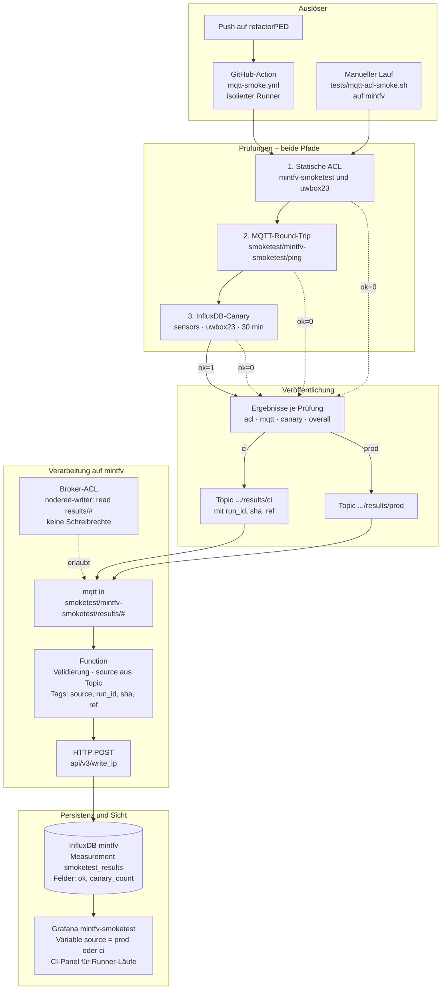

# Smoketest-Datenfluss

Dieses Diagramm zeigt, wie Smoketest-Ergebnisse von der GitHub-Action bzw. einem manuellen Lauf über MQTT und Node-RED in InfluxDB gelangen und im Grafana-Dashboard sichtbar werden. Es ergänzt die textliche Dokumentation in `10_Doku_Code_Abgleich_2026-11.md` und den archivierten OpenSpec-Change `ci-smoketest-results-ingest`.

## Legende

- **Auslöser:** Die GitHub-Action läuft bei jedem Push gegen einen isolierten Wegwerf-Stack auf dem Runner. Der manuelle Lauf läuft direkt auf `mintfv` gegen den Produktionsbroker.
- **Prüfungen:** beide Pfade prüfen die statischen ACL-Regeln, einen MQTT-Round-Trip im Test-Namespace und aktuelle InfluxDB-Punkte des Referenzgeräts `de-hh-mintfv-uwbox23`.
- **Herkunft:** `source=prod` bedeutet manueller Lauf auf `mintfv`; `source=ci` bedeutet isolierter Runner der GitHub-Action. **CI-Ergebnisse beschreiben nicht den Produktionszustand.**
- **Topic-Schema:** `smoketest/mintfv-smoketest/results/prod` bzw. `.../results/ci`. Die Identität `mintfv-smoketest` darf nur unter `smoketest/mintfv-smoketest/#` schreiben; `nodered-writer` darf das Ergebnis-Topic lesen und besitzt keine MQTT-Schreibrechte.
- **Datenhaltung:** Node-RED schreibt in die bestehende Datenbank `mintfv`, Measurement `smoketest_results`, mit den Feldern `ok` und `canary_count` sowie den Tags `check`, `source` und bei CI zusätzlich `run_id`, `sha`, `ref`.
- **Fehlerpfad (gestrichelt):** bei einer Abweichung werden `ok=0` für die betroffene Prüfung und für `overall` veröffentlicht; der Lauf endet mit einem von Null verschiedenen Exitcode.
- **Sichtbarkeit:** Das Dashboard `mintfv-smoketest` filtert über die Variable `source` (Default `prod`); ein eigenes Panel zeigt CI-Läufe mit `run_id`, `sha` und `ok`.
